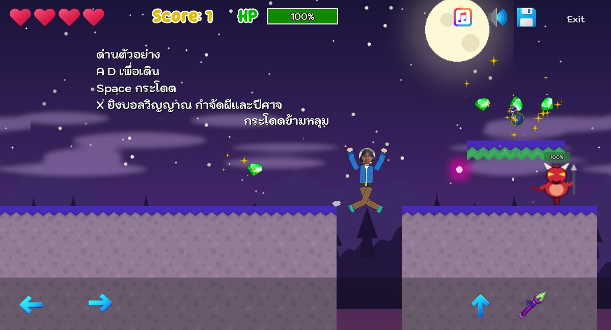
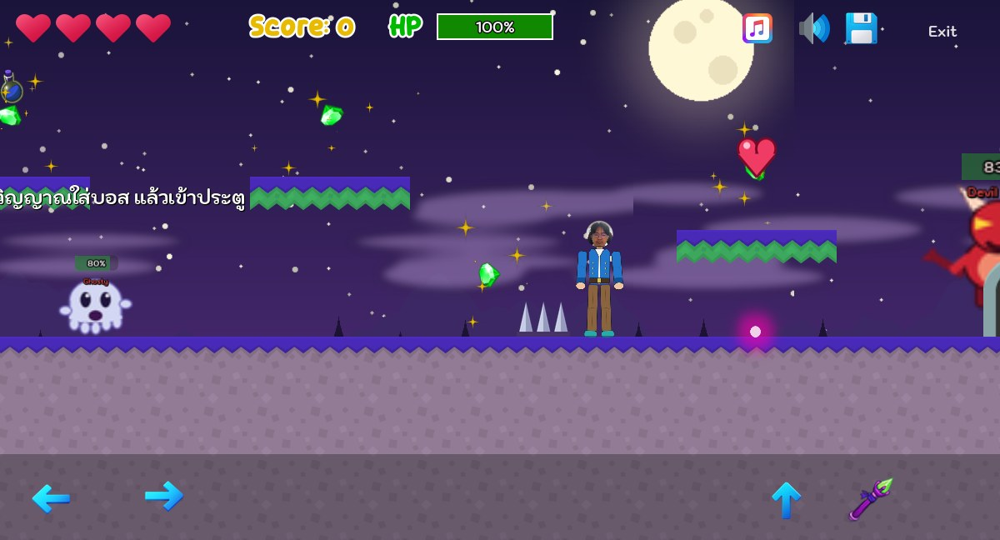
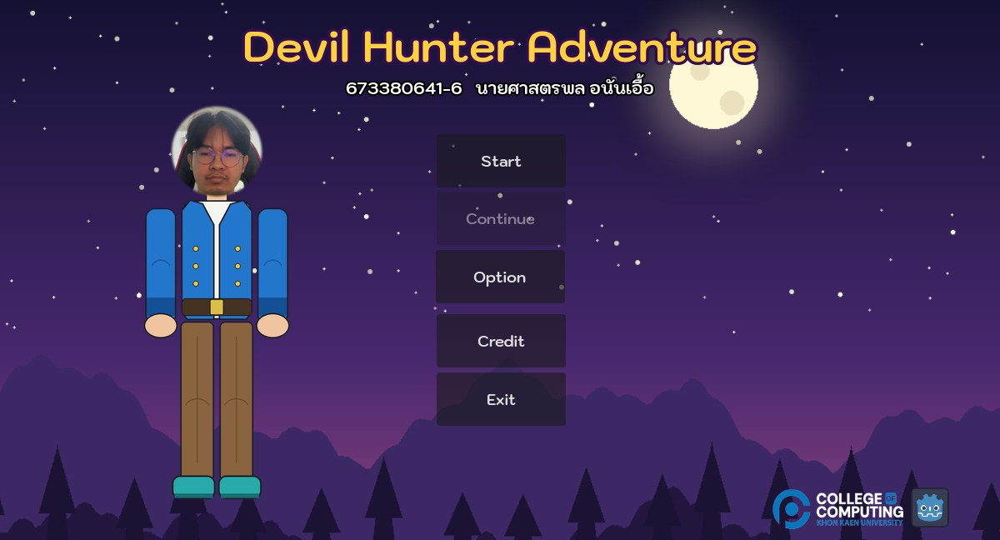

# Game Lab 4 : Devil Hunter Adventure

**รหัสนักศึกษา:** 673380641-6  **ชื่อ-สกุล:** นายศาสตรพล อนันเอื้อ
**รายวิชา:** Computer Game Development — College of Computing, Khon Kaen University

เกม 2D Platformer Side-Scrolling ที่พัฒนาต่อจาก [2D-Platformer-Starter-Kit](https://github.com/computingkku/2D-Platformer-Starter-Kit) ด้วย Godot 4.7

## ลิงก์
- 🎮 **เล่นเกม (GitHub Pages):** https://sattraphona-pixel.github.io/GameLab4/
- 🎬 **VDO Demo:** _(ใส่ลิงก์ Google Drive / YouTube ที่นี่)_
- 💻 **Source code:** https://github.com/sattraphona-pixel/GameLab4

## ภาพตัวอย่าง
  

## Game Story
นักล่าปีศาจ “แซท ฮันเตอร์” (ตัวละครที่สร้างจาก Lab 3 โดยใช้ใบหน้าของผู้พัฒนา) เดินทางผ่านป่าวิญญาณ ซากปรักหักพังลอยฟ้า และหุบเขาหนาม
เพื่อไปล้างบางราชาปีศาจในถ้ำสุดท้าย เก็บอัญมณีและไอเท็ม ยิงบอลวิญญาณกำจัดผีและปีศาจ แล้วเข้าประตูเพื่อไปด่านต่อไป

## สิ่งที่แก้ไข / เพิ่มจาก Starter Kit
| ขั้นตอน | สิ่งที่ทำ |
|---|---|
| เมนู | ชื่อเกม + รหัส/ชื่อผู้พัฒนา, ปุ่ม **Exit** (`get_tree().quit()`), พื้นหลังท้องฟ้ากลางคืน และตัวละคร |
| Credit | แสดงรหัส ชื่อ-สกุล และภาพประกอบ (ใบหน้า + ตัวละคร) |
| Player | เปลี่ยนเป็นตัวละคร Skeleton2D จาก Lab 3 (Idle / Walk / Jump / Attack) |
| Enemy | ผี (Ghosty) และปีศาจ (Imp) วาดสไปรต์ใหม่ + บอส Devil King (HP 300) ในด่าน 4 + ตัว Spawner |
| อาวุธ/กระสุน | บอลวิญญาณสีม่วง (ปรับจากบอลไฟเดิม) และไอคอนไม้เท้าใหม่ |
| ไอเท็ม | ⚡ **Speed Boost** (วิ่งเร็วขึ้น 6 วินาที), ❤️ **Extra Life** (เพิ่มชีวิต), ยาเพิ่ม HP (สีน้ำเงิน), อัญมณีสีเขียว |
| กับดัก | หนามแหลม (`spike_trap.tscn`) และเลื่อยหมุน; แก้บัก: ชนกับดักแล้วเสียชีวิตซ้ำหลายครั้ง |
| ด่าน | ออกแบบใหม่ 4 ด่าน (`level_01`–`level_04`) ใช้ TileMapLayer + TileSet สีใหม่ที่ตั้งค่า Collision Polygon แล้ว |
| พื้นหลัง | Parallax2D 2 ชั้น (ท้องฟ้า/ภูเขา และเนินป่า/หมอก) |
| GameOver / Win | เพิ่มภาพประกอบ ข้อความ และเสียงเพลงประจำฉาก |
| เสียง | เพลงพื้นหลังและเสียงเอฟเฟกต์ใหม่ (สังเคราะห์ด้วยโปรแกรมเอง) |

## วิธีเล่น
| ปุ่ม | การทำงาน |
|---|---|
| A / ← | เดินซ้าย |
| D / → | เดินขวา |
| Space / W | กระโดด (กระโดดสองชั้นได้) |
| X | ยิงบอลวิญญาณ |

บนมือถือ/เว็บ มีปุ่มสัมผัสบนหน้าจอ

## โครงสร้างโปรเจกต์
```
Scenes/
├── Actors/      # Player, ผี, ปีศาจ, Spawner
├── Levels/      # menu, credit, level_01–04, game_over, game_win
├── Managers/    # GameManager, SceneTransition, AudioManager
├── Prefabs/     # กระสุน เหรียญ ไอเท็ม กับดัก TileSet
└── Sprites/     # student_lab3.tscn (ตัวละคร Skeleton2D จาก Lab 3)
Assets/          # Spritesheet, Night (ฉากหลัง), Sound, Fonts
docs/            # Web export (index.html) และภาพ demo
```
